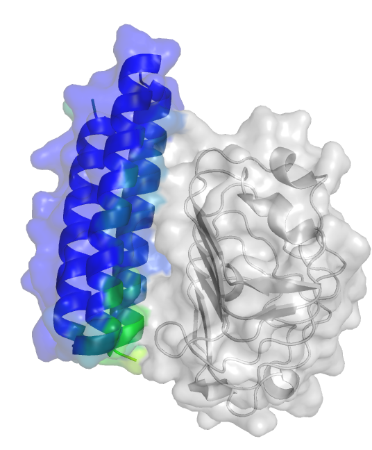

# Containerized *De Novo* Protein Binder Design Pipeline

An end-to-end, cloud-native computational platform for designing protein binders from scratch.

This pipeline orchestrates five state-of-the-art deep learning models across isolated, fully containerized GPU environments. Driven through clean Python wrappers, an interactive Jupyter notebook, and (soon) scalable Snakemake workflows, it aims to deliver a reproducible design funnel from target surface analysis to wet-lab-ready lead candidates.

<p align="center">
  
</p>

## Key Highlights

* **Fully containerized and reproducible:** every engine (`RFdiffusion`, `ProteinMPNN`, `ESMFold`, `Boltz-2`, `ColabFold`/AlphaFold-Multimer) runs inside its own pinned, self-contained Docker image, so there is no dependency friction between stages.
* **Interactive prototyping, automated scaling:** prototype a campaign in the notebook, then hand the same `pipeline/` modules to Snakemake for high-throughput execution.
* **Tiered quality funnel:** candidates are filtered sequentially through sequence scoring, monomer self-consistency, and dual-engine complex interface metrics — maximizing hit rates while conserving compute.
* **One source of truth:** every threshold, path, and tool pin lives in [`config/campaign.yaml`](config/campaign.yaml).

## Pipeline Overview

```
RFdiffusion ──> ProteinMPNN ──> ESMFold ──> Boltz-2 ──> ColabFold + Boltz-2
 backbones       sequences      3A gate     3B gate       complex scoring
```

**Step 0 — Target surface preparation and hotspots.** Quality-checks user-defined target hotspots, or identifies candidate binding pockets using geometric surface analysis.

**Step 1 — Backbone generation (`RFdiffusion`).** Generates *de novo* binder backbones focused on the selected target hotspot residues.

**Step 2 — Fixed-backbone sequence design (`ProteinMPNN`).** Designs soluble amino acid sequences that pack tightly against the target interface.

**Step 3 — Monomer self-consistency (`ESMFold`, then `Boltz-2`).** Screens single-chain structures to confirm sequence-to-backbone fidelity (`pLDDT` and `scRMSD`), filtering out misfold-prone designs early. Step 3A is the cheap gate, Step 3B the precise one.

**Step 4 — Complex interface validation (`Boltz-2` and `ColabFold`).** Evaluates target–binder interactions side by side to isolate top-tier leads for wet-lab synthesis. `pae_interaction` is the primary gate; `ipTM` is secondary.

## Setup and Installation

### Hardware and System Requirements

* **Supported GPUs:** NVIDIA Ampere (`sm_80`/`sm_86`) and Ada Lovelace (`sm_89`) — including **A10**, **A100**, **L40S**, and **RTX 6000 Ada**.
  * *Note:* Hopper (H100) and Blackwell (B200) are **not** currently supported. Some pinned binaries compile only up to `sm_80` with no PTX fallback, so `sm_90+` devices cannot run them.
* **VRAM and storage:** minimum **24 GB VRAM** and **~120 GB free NVMe** for container images, model weights, and workspace caches. For production-scale campaigns (N > 10,000 designs), plan on ≥500 GB on the primary compute volume or attached persistent block storage.
* **NVIDIA driver:** version ≥535, with the NVIDIA Container Toolkit installed.
* **GPU topology:** one GPU per container run. Scaling across multiple GPUs will be handled by Snakemake.

### 1. Provision a GPU Instance

Deploy a cloud or local GPU instance running Ubuntu 22.04 LTS. For a step-by-step walkthrough on cloud providers such as Lambda Labs, see [`docs/CLOUD_SETUP.md`](docs/CLOUD_SETUP.md).

Once the instance is live, open an interactive SSH session and continue below.

### 2. Clone the Repository

Clone onto your primary workspace storage volume:

```bash
git clone https://github.com/paymantohidifar/protein-binder-design-pipeline.git --branch main binder_repo
cd binder_repo
```

### 3. Verify Docker Privileges

All pipeline stages run inside isolated, pinned Docker containers. Configure non-root Docker privileges and verify container runtime access:

```bash
bash scripts/setup_docker.sh
```

> Follow any terminal prompts (for example, refreshing your user group session) to apply the updated permissions.

### 4. Run the Pre-Flight System Check

Before building images or fetching weights, run the environment inspector to verify CUDA drivers, GPU topology, disk capacity, and container runtime prerequisites:

```bash
bash scripts/bootstrap_instance.sh --check
```

> This catches hardware mismatches and missing dependencies before you start large downloads or container builds.

### 5. Build the Environment and Cache Weights

Once the pre-flight check passes, bootstrap the instance. This installs the [Pixi](https://pixi.sh) package manager, sets up the host Python environment, builds all five pinned Docker images (~50 GB total), and pre-fetches model weights (~18 GB) into a host-mounted cache volume:

```bash
bash scripts/bootstrap_instance.sh --all
```

> Expect **20–20 minutes**, depending on network bandwidth and disk I/O. The `--images` and `--prefetch` flags run those two halves separately. Follow any post-build prompts to finish setup.

### 6. Run the Test Suite

Verify the host setup, wrapper behavior, and container volume mounting. The suite is CPU-only, no GPU needed:

```bash
# Standard run
pixi run test

# Per-test output
pixi run test-verbose
```

## Interactive Prototyping

[`notebooks/01_binder_design_prototype.ipynb`](notebooks/01_binder_design_prototype.ipynb) walks through the whole pipeline step by step. It covers the biophysical reasoning behind each model while letting you run a **smoke-test campaign (5–10 binders)** to verify your instance setup, inspect metric distributions, and tune stage parameters before scaling up.

The example campaign targets the **human insulin receptor L1/E1 domain**, using three surface phenylalanines (**A59 / A83 / A91**) as the epitope anchor.

### Jupyter Kernel Setup

1. **Refresh your shell** so `pixi` is on your `PATH`:
   ```bash
   source ~/.bashrc
   ```

2. **Register the Pixi environment as a Jupyter kernel:**
   ```bash
   pixi run register-kernel
   ```
   This registers a kernel displayed as **`Python (Pixi: default)`**.

3. **Reboot the instance** to clear Jupyter's cached kernel registry:
   ```bash
   sudo reboot
   ```

4. **Launch Jupyter and select the kernel.** Open the notebook and choose **`Python (Pixi: default)`** from the kernel menu — the notebook ships with a standard `python3` spec, so pick the Pixi kernel manually on first launch.

### CPU-Only Smoke Test (No GPU Required)

To verify file paths, container mounts, and pipeline wiring without spending GPU compute:

```bash
pixi run notebook-dry-run
```

> The dry run executes the notebook with container calls stubbed out, validating plumbing and data flow only. To generate real structures and binder metrics, run the full notebook on a GPU instance.

## Production-Scale Runs

> **Note:** the automated Snakemake workflow for multi-GPU scaling is still under active development.

### Data Privacy and Remote API Calls

All core models run locally inside containers with no external database lookups — with one explicit exception:

* **ColabFold and Boltz-2 (MSA mode):** in MSA mode these models query the public MMseqs2 API at `api.colabfold.com` to build sequence alignments, so target sequence data leaves the host.
* **Privacy option:** if that is a concern, run the Step 4 complex predictions with **Boltz-2 in single-sequence mode**, or point the pipeline at a trusted MSA server you control. A single `msa_mode` setting in `config/campaign.yaml` drives both Boltz-2 stages.

## Repository Layout

```
.
├── config/
│   └── campaign.yaml            # Single source of truth — gates, paths, tool pins
├── pipeline/                    # Modular Python library shared by notebook and Snakemake
│   ├── docker.py                # Container wrapper, volume and GPU allocation
│   ├── runlog.py                # Per-run transcripts and pipeline event log
│   ├── pdb_io.py                # PDB/mmCIF structure parsing (Bio.PDB)
│   ├── trb.py                   # RFdiffusion metadata extraction
│   ├── hotspots.py              # Geometric pocket analysis and hotspot validation
│   ├── metrics.py               # Quality scoring and statistical evaluation
│   ├── inputs.py                # Step 4 manifest generators (YAML/FASTA)
│   ├── parsers.py               # Tool output → flat record, for all five engines
│   ├── report.py                # Campaign registry: gating, ranking, funnel reporting
│   └── viz.py                   # Structure visualization and alignment helpers
├── docker/                      # One image per engine, each documenting its provenance
│   ├── rfdiffusion/Dockerfile
│   ├── proteinmpnn/Dockerfile
│   ├── esmfold/Dockerfile
│   ├── boltz2/Dockerfile
│   ├── colabfold/Dockerfile
│   ├── build_all.sh             # Ordered image builds, then GPU-compatibility probes
│   └── README.md                # Image matrix and build notes
├── scripts/
│   ├── setup_docker.sh          # Non-root Docker privilege setup
│   ├── bootstrap_instance.sh    # Pre-flight check and environment installer
│   └── dry_run_notebook.py      # Notebook execution with containers stubbed
├── notebooks/                   # Interactive prototyping and smoke-test notebooks
├── tests/                       # Host test suite (CPU-only, no GPU required)
├── inputs/                      # Target PDB structures and epitope specifications
├── results/                     # Campaign outputs, parsed metrics, container runlogs
└── docs/                        # Spec of record, setup guides, architecture notes
```

## License

Released under the [MIT License](LICENSE).

## Acknowledgements

This project is an orchestration framework. The scientific models and the deep learning architectures behind them belong to their respective authors and research groups:

* **RFdiffusion** — Baker Lab, Institute for Protein Design, University of Washington ([Watson et al., 2023](https://www.nature.com/articles/s41586-023-06415-8)).
* **ProteinMPNN / SolubleMPNN** — Baker Lab, Institute for Protein Design, University of Washington ([Dauparas et al., 2022](https://www.science.org/doi/10.1126/science.add2187)).
* **ESMFold** — Meta AI FAIR Protein Team ([Lin et al., 2023](https://www.science.org/doi/10.1126/science.ade2574)).
* **Boltz-2** — MIT and MIT–IBM Watson AI Lab ([Passaro et al., 2025](https://doi.org/10.1101/2025.06.14.659707); [jwohlwend/boltz](https://github.com/jwohlwend/boltz)).
* **ColabFold** — Steinegger and Söding labs ([Mirdita et al., 2022](https://www.nature.com/articles/s41592-022-01488-1)).